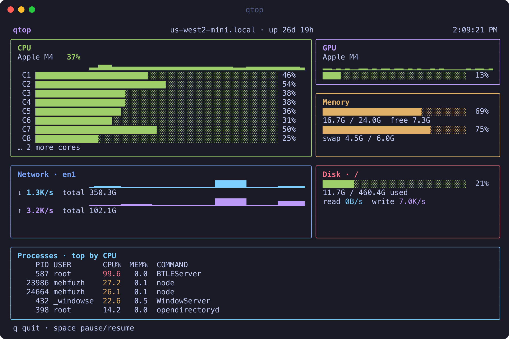

# qtop

A btop-like tiled system monitor for your terminal, built with TypeScript, Ink, and systeminformation.



## Tiles
- **CPU** — overall load, animated 3-D wave history, per-core bars
- **GPU** — live utilization (macOS via `ioreg`, NVIDIA via `nvidia-smi`), VRAM when available
- **Memory** — RAM + swap usage
- **Network** — download/upload rates with auto-scaling 3-D waves

CPU/GPU/Network histories render as moving 3-D wave bars: solid front bars
with a rippling back wall for depth, animated ~8×/s (frozen while paused).
- **Disk** — root filesystem usage + read/write throughput
- **Processes** — top processes by CPU

Tiles are movable: `Tab` selects a tile (white border, ◆ marker) and the arrow
keys swap it with the neighbouring tile in that direction. The slot sizes stay
fixed, so any tile can live in any slot and the layout still reflows on resize.

## Install with curl (from the GitHub release)
Requires Node.js 18+ and npm. Downloads the release source, builds it, and
links the `qtop` command globally:
```sh
curl -fsSL https://raw.githubusercontent.com/mehfuzh/qtop/main/install.sh | bash
```
Pick a specific release with `QTOP_VERSION` (defaults to `v0.2.0`):
```sh
curl -fsSL https://raw.githubusercontent.com/mehfuzh/qtop/main/install.sh | QTOP_VERSION=v0.2.0 bash
```
Then run `qtop` from any terminal (at least 80×24). To uninstall: `npm unlink -g qtop`.

## Run from source
```sh
npm install
npm run dev
```

## Keys
- `q` / `Esc` / `Ctrl+C` — quit
- `space` — pause/resume sampling
- `Tab` / `Shift+Tab` — select next/previous tile
- `←` `↑` `↓` `→` — move the selected tile (swaps with its neighbour)

## Build
```sh
npm run build
npm start
```

## Launch as `qtop`
Install the `bin` entry globally so you can type `qtop` in any terminal:
```sh
npm run build
chmod +x dist/index.js
npm link
```
Then run `qtop` from anywhere (needs a real terminal at least 80×24).
The link points at this folder's `dist/`, so after changing the source just
re-run `npm run build` — no relink needed. To remove the global command:
```sh
npm unlink -g qtop
```

## Test
Automated tests (Node's built-in test runner via tsx — no extra dependencies):
```sh
npm test
```
- `tests/format.test.ts` / `tests/graph.test.ts` — unit tests for formatting and graph rendering
- `tests/layout.test.ts` — unit tests for tile moving/selection
- `tests/stats.test.ts` — smoke test that collects real stats from this machine and checks they're sane

Type-check without emitting:
```sh
npm run typecheck
```

Manual test of the TUI (needs a real terminal at least 80×24):
1. `npm start` (built) or `npm run dev` (source)
2. Check each tile updates ~once per second; sparklines grow over time
3. Generate load (e.g. a download or `yes > /dev/null`) and watch CPU/network/process tiles react
4. `space` pauses sampling (header shows ⏸ PAUSED), `space` again resumes
5. Resize the terminal — layout should reflow; below 80×24 a warning is shown
6. `Tab` cycles the selected tile (white border); arrow keys swap it with its
   neighbour; moving back restores the original arrangement
7. `q` or `Esc` quits cleanly

## Screenshot
The README screenshot is generated from real stats on this machine — it renders
the actual tiles off-screen and converts the ANSI frame to an image:
```sh
npm run screenshot                                   # writes docs/screenshot.svg
rsvg-convert --zoom=2 -o docs/screenshot.png docs/screenshot.svg   # brew install librsvg
```

## Release
Tagged releases live at https://github.com/mehfuzh/qtop/releases.
To cut a new one: bump `version` in `package.json`, update `QTOP_VERSION`'s
default in `install.sh`, then `git tag -a vX.Y.Z -m … && git push origin vX.Y.Z`
and `gh release create vX.Y.Z`.

## Contributing
Contributions are welcome — see [CONTRIBUTING.md](CONTRIBUTING.md) for setup,
testing expectations, and pull request guidelines.

## License
[MIT](LICENSE) © mehfuzh
